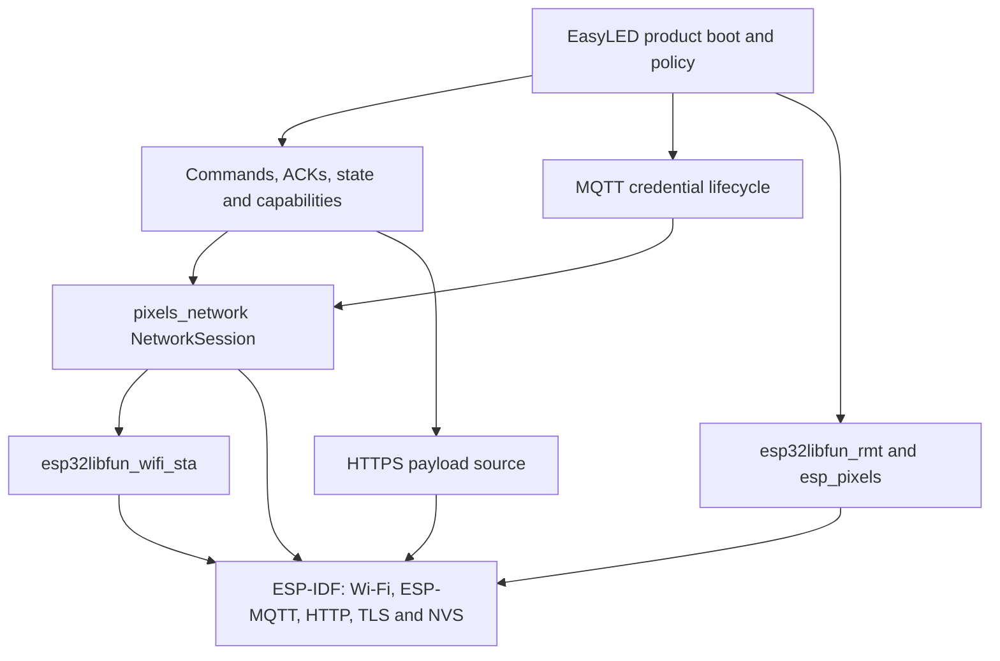

# EasyLED firmware connectivity architecture

Status: current architecture and extraction direction, recorded 2026-10-18.

## Plain-language summary

EasyLED **does use `esp32libfun`**. The framework supplies the thin hardware and
ESP-IDF foundation, while this repository supplies the rules that make the
device an EasyLED product.

Connectivity is currently hybrid:

- Wi-Fi station setup and connection state use `esp32libfun_wifi_sta`;
- MQTT/WSS uses ESP-MQTT through the firmware-owned `pixels_network` component;
- HTTPS uses `esp_http_client` through the firmware-owned injectable HTTP
  boundary;
- credential rotation, topics, commands, acknowledgements, durable state and
  recovery remain EasyLED product behavior.

This split is intentional while the M0 contract is being validated. It is not
a decision to maintain an unrelated networking framework inside EasyLED
forever. Before extracting generic MQTT or HTTPS wrappers, compare this code
with the communication pattern already used by the field IIoT device. Reuse or
consolidate that proven pattern where the contracts match; do not create a
third competing abstraction.

## Current dependency model

The firmware pins its dependencies as Git submodules. A firmware release is
therefore built against known revisions instead of silently consuming the
latest framework checkout.

## Ownership by layer

| Responsibility | Current owner | Why |
| --- | --- | --- |
| Wi-Fi STA initialization and connection state | `esp32libfun_wifi_sta` | Thin reusable wrapper over ESP-IDF |
| Wi-Fi retry timing | `easyled-firmware/components/pixels_network` | Application policy |
| MQTT/WSS client lifecycle, bounded receive queue and PUBACK tracking | `pixels_network::NetworkSession` | Product-local transport adapter while the common abstraction is evaluated |
| HTTP download mechanics | `pixels_control::EspHttpPayloadClient` | Injectable adapter over `esp_http_client` |
| HTTPS payload limits, checksum and fail-closed behavior | `pixels_control::HttpsPayloadSource` | EasyLED delivery contract |
| MQTT credential persistence, rotation and ambiguous activation recovery | `pixels_mqtt_credentials` | EasyLED device provisioning contract |
| Connection of credential controller to the live MQTT session | `pixels_mqtt_session_adapter` | Small application adapter; the only component depending on both sides |
| Command envelope, events, state and capability serialization | `pixels_firmware_contract` | EasyLED wire contract |
| Deduplication and durable apply transaction | command executor and durable storage components | EasyLED product behavior |
| Pixel signal generation | `esp32libfun_rmt` and `esp_pixels` | Reusable hardware/transport libraries |
| Effects and composition | `esp_pixels_fx` and `esp_pixels_composer` | Reusable pixel-domain libraries |

## What the current design already protects

- Rendering and local recovery continue without a network connection.
- MQTT callbacks do not execute product commands.
- Buffers and queues are bounded.
- TLS certificate and hostname verification remain enabled.
- Provisioned mode does not fall back silently to laboratory credentials.
- `command_applied` is emitted only after durable persistence and confirmed
  activation.
- Duplicate command IDs replay their durable terminal result instead of
  applying the command again.
- Wi-Fi and MQTT identity have separate lifecycles, allowing a credential to
  rotate without tearing down Wi-Fi or pixel rendering.

## Why MQTT and HTTPS are not core modules yet

The present MQTT and HTTPS code was developed together with an evolving EasyLED
contract. Promoting it too early into `esp32libfun` would risk putting product
rules such as topics, device identity, command ACKs and credential recovery in
the HAL core.

The framework rule remains:

- a generic ESP-IDF mechanism may become a small reusable wrapper;
- EasyLED policy stays in `easyled-firmware`;
- an external reusable `esp_*` library depends only on the specific
  `esp32libfun_*` modules it needs;
- the `esp32libfun` core stays small and contains no EasyLED contract.

## Consolidation direction after M0

This is a planned architecture review, not authorization to refactor the M0
critical path now.

1. Inventory the field IIoT device's networking components, public API,
   lifecycle, TLS model, retry policy and field evidence.
2. Compare them with `NetworkSession` and `EspHttpPayloadClient` using a small
   compatibility table.
3. Identify transport-only behavior shared by both products.
4. Prefer the already field-proven abstraction when it satisfies both uses.
5. Extract only generic mechanics, potentially as thin `esp32libfun_*`
   wrappers or external `esp_*` connectivity libraries according to scope.
6. Keep EasyLED envelopes, topics, credentials, ACK rules, staging and recovery
   in this repository.
7. Migrate one product at a time with focused validation and hardware evidence.

Candidate generic surfaces include MQTT/WSS lifecycle and PUBACK observation,
bounded MQTT message assembly, and a bounded verified HTTPS client. Their final
names and repository ownership remain undecided until the IIoT audit.

## Current evidence and limits

At firmware `main` commit `89ed3ae`, the automated gates are:

- `validation/`: 468/468 checks;
- `validation_mqtt_credentials/`: 298/298 checks;
- `validation_mqtt_session/`: 98/98 checks.

These gates validate the code paths with QEMU and deterministic fakes. They do
not prove a live broker, deployed backend, real TLS timing or field reliability.
Those require the coordinated M0 bench window.

## Source-of-truth rule

- This document explains the boundary and the intended extraction direction.
- Public component behavior remains defined by headers, `README.md`, tests and
  the commit history in this repository.
- `esp32libfun` remains canonical for its own core wrappers.
- The IIoT repository remains canonical for its existing field communication
  implementation until an explicit consolidation decision is made.
- Vault notes index this decision for humans but do not replace repository
  contracts.
